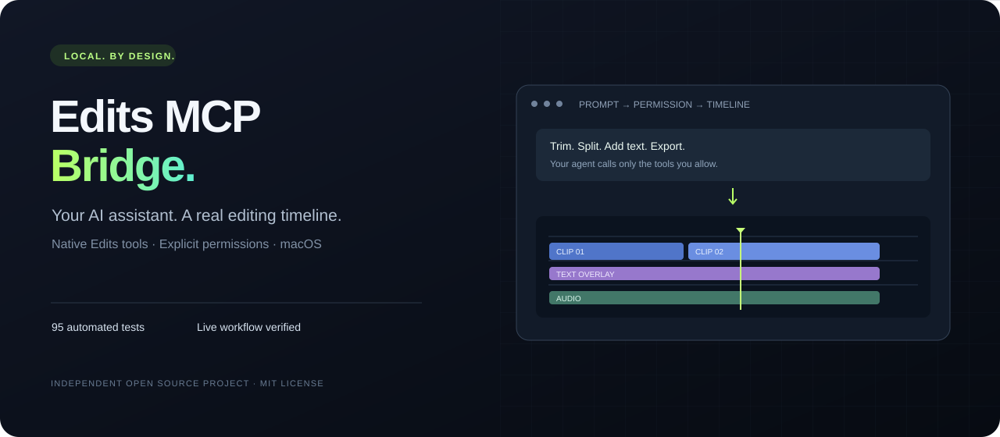
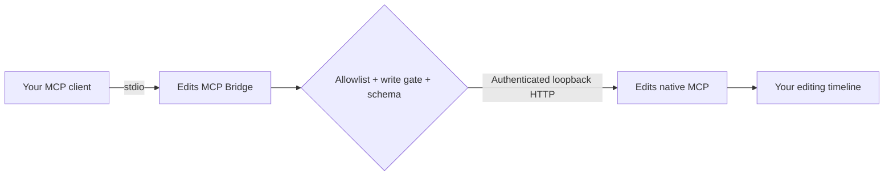

<p align="center"></p>

<h1 align="center">Edits MCP Bridge</h1>
<p align="center"><strong>Connect your AI assistant to Instagram Edits on macOS.</strong><br>Discover native tools, control your timeline, and export video — with explicit permissions.</p>
<p align="center"><a href="#quick-start">Quick start</a> · <a href="#live-demo">Live demo</a> · <a href="TESTING.md">Test evidence</a> · <a href="SECURITY.md">Security</a> · <a href="README.tr.md">Türkçe</a></p>
<p align="center"><a href="LICENSE"></a>  </p>

An independent, local MCP server that bridges **stdio MCP clients** to the **Automation MCP endpoint built into Edits**. It discovers Edits' actual tools and schemas rather than inventing an editing API.

**Live verified:** authenticated discovery of **274 native tools**, plus project creation, media import, trim, split, text overlay, save/reopen, and video export on Edits **454.0.0**. Tool availability varies by app version and screen; discovery does **not** mean every tool was tested. [See the acceptance report →](docs/LIVE_ACCEPTANCE.md)

> This is a community project, not a Meta or Instagram product. Edits must be installed separately. The bridge does not provide an editor, cloud rendering, or an Instagram scraping API.

## Why this bridge?

| Feature | What you get |
| --- | --- |
| **Native integration** | Edits' built-in authenticated MCP endpoint, not fragile screen coordinates. |
| **Permission gate** | An exact tool allowlist. Writes require a second, explicit switch. |
| **Validated inputs** | Native JSON schemas checked before dispatch, without coercion or mutation. |
| **Local connection** | Stdio to the client, IPv4 loopback to Edits. No bridge telemetry or cloud relay. |
| **Predictable failure** | Timeouts, cancellation, bounded payloads and no automatic editing-call retries. |
| **Visible evidence** | 95 automated tests and a real import → edit → export acceptance run. |

## How it connects



[See inspected native editing recipes →](docs/RECIPES.md)

## Live demo


Actual output from a dedicated test project: a six-second generated clip was trimmed to five seconds, split into two timeline clips, overlaid with text and exported through MCP. The file was independently probed and fully decoded: **5.000 s · 2560×1440 · 30 fps · HEVC + AAC**. The demo contains only generated test media.

## Quick start

### 1. Install

Requirements: **macOS with Edits**, **Node.js 22+**, npm and `/usr/bin/python3` for the local diagnostic tool.

```sh
git clone https://github.com/vizyonajans/edits-mcp.git
cd edits-mcp
npm ci --ignore-scripts
npm run smoke
```

The local smoke test starts the stdio server and discovers the bridge tools. It does not modify Edits or require a token.

### 2. Enable Edits Automation

In Edits, open **Settings → Automation**, enable **Automation Server** and copy the access token. Use the endpoint displayed by your installed app. The observed default is:

```text
http://127.0.0.1:19501/mcp
```

Save the token privately from an interactive Terminal:

```sh
mkdir -p "$HOME/.config/edits-mcp"
chmod 700 "$HOME/.config/edits-mcp"
python3 scripts/save-token.py "$HOME/.config/edits-mcp/access.token"
```

The saver hides the input, creates a private `0600` file and refuses to overwrite an existing file. **Do not put the token in this repository, chat, a GitHub issue, or a command-line argument.**

### 3. Add your MCP client

Use your client's stdio MCP configuration. Replace the three absolute paths below. `command -v node` shows the Node executable path.

```json
{
  "mcpServers": {
    "edits-local": {
      "command": "/absolute/path/to/node",
      "args": ["/absolute/path/to/edits-mcp/src/server.mjs"],
      "env": {
        "EDITS_MCP_URL": "http://127.0.0.1:19501/mcp",
        "EDITS_TOKEN_FILE": "/absolute/private/path/access.token",
        "EDITS_ALLOWED_TOOLS": "[]",
        "EDITS_ALLOW_WRITES": "0"
      }
    }
  }
}
```

Restart the client, call `edits_status`, then `edits_catalog`. A complete example is in [examples/mcp.json](examples/mcp.json). GUI clients may not inherit your Terminal PATH, so use absolute paths.

### 4. Allow only the tools you need

Start with inspected, read-only tools from your **current** native catalog:

```json
{
  "EDITS_ALLOWED_TOOLS": "[\"state\",\"clips\"]",
  "EDITS_ALLOW_WRITES": "0"
}
```

Then call:

```json
{
  "name": "edits_invoke",
  "arguments": {
    "name": "state",
    "arguments": {}
  }
}
```

For editing, add the exact tools you reviewed and explicitly set `EDITS_ALLOW_WRITES` to `"1"`. Never add tools you do not understand. A native tool may export, delete, publish or access files; an allowlist entry grants that tool's actual capabilities.

### Important: macOS file access

Edits' own sandbox still applies. **A path string is not a file-access grant.** The live test initially received a native sandbox-bookmark error. Selecting the generated video through **Edits → File → Import Media** granted access; the subsequent MCP import succeeded.

Export to a directory Edits can access. An arbitrary output directory was denied in the test; the export folder established by Edits' own export flow worked. Always poll `exportStatus` and verify the output file: `export` returning `ok: true` means the job was accepted, not that encoding completed.

No Accessibility, Apple Events or Screen Recording permission is required by this bridge. Other Edits features may have their own OS permissions. Do not disable macOS protections to make a call work.

## Bridge tools

| Tool | Purpose |
| --- | --- |
| `edits_status` | Inspect the local Edits installation, signature check and bridge policy. |
| `edits_catalog` | Fetch the actual native tool catalog, including input schemas and annotations. |
| `edits_invoke` | Invoke an exact native tool, subject to the allowlist, write gate and schema validation. |

The native catalog can change between the home and editor screens. Every invocation refreshes it before authorization and dispatch.

## Configuration

| Variable | Default | Purpose |
| --- | --- | --- |
| `EDITS_MCP_URL` | `http://127.0.0.1:19501/mcp` | Exact loopback `/mcp` endpoint; redirects and URL credentials/query/fragment are rejected. |
| `EDITS_TOKEN_FILE` | Unset | Absolute path to an owned, private, regular non-symlink token file. |
| `EDITS_ALLOWED_TOOLS` | `[]` | JSON array of exact native names. No wildcard. |
| `EDITS_ALLOW_WRITES` | `0` | `1` additionally permits reviewed write/unknown-effect tools. |
| `EDITS_TIMEOUT_MS` | `10000` | Total native-operation deadline, 100–120000 ms. |

The default configuration allows catalog discovery, but **no native tool invocation**. Read-only native tools also require an allowlist entry and a trustworthy `readOnlyHint` when the write gate is closed. Annotations are hints, not a safety guarantee.

The bridge limits native catalogs to 2000 tools/100 pages, the request queue to 32 calls, HTTP responses to 8 MiB, serialized argument length to 1 MiB and schema length to 256 KiB. JSON string lengths use JavaScript string units. Supported structural schema dialects are draft-07 and draft-2020-12; format annotations are not enforced.

**A timeout or cancellation does not roll back an edit.** Inspect Edits before retrying. The bridge never automatically replays a native editing call. [Read the full security model →](SECURITY.md)

## Test it yourself

```sh
npm test
npm run test:coverage
npm run test:python
npm run smoke
```

For authenticated, read-only discovery against your running app:

```sh
EDITS_TOKEN_FILE=/absolute/private/path/access.token npm run smoke:live
```

This script discovers the catalog without invoking native editing tools. More detail: [automated test report](TESTING.md), [live acceptance evidence](docs/LIVE_ACCEPTANCE.md), and [sanitized results](docs/reports/live-acceptance.json).

## Troubleshooting

| Result | Next step |
| --- | --- |
| `TOKEN_MISSING` | Set an absolute `EDITS_TOKEN_FILE` path in the client's environment. |
| `TOKEN_FILE_UNSAFE` | Check file ownership, mode, size and that it is a regular non-symlink file. |
| `UPSTREAM_FAILED` | Check Edits, Automation, endpoint, token and protocol compatibility. |
| `POLICY_DENIED` | Review the exact allowlist and write flag; restart the client after changes. |
| `INVALID_ARGUMENTS` | Use the current native tool's input schema. |
| `SCHEMA_UNSUPPORTED` | The native schema cannot be safely validated; the tool was not called. |
| Native file-access error | Grant access through Edits' own file picker or use its accessible export directory. |

## Privacy

This repository contains no access tokens, personal email addresses, home-directory paths, private project data or machine-specific diagnostic reports. Its demo is synthetic. The bridge has no telemetry and sends authenticated requests only to the configured loopback endpoint. Local diagnostic outputs are for your MCP client and should not be pasted publicly without review. [Privacy and publication policy →](PRIVACY.md)

## Contributing

Bug reports, compatibility reports and small, well-tested improvements are welcome. Read [CONTRIBUTING.md](CONTRIBUTING.md) before opening a pull request. Include whether a result came from a fixture or the actual Edits app. Never post tokens or private media.

If this helps your workflow, a star makes it easier for other creators and developers to discover the project.

## Contact and license

- Questions and bugs: [GitHub Issues](https://github.com/vizyonajans/edits-mcp/issues)
- Professional enquiries and private security reports: [info@vizyoncreative.com](mailto:info@vizyoncreative.com)
- [MIT License](LICENSE)

Edits and Instagram are trademarks of their respective owners. This project is independent and is not endorsed by Meta or Instagram.
