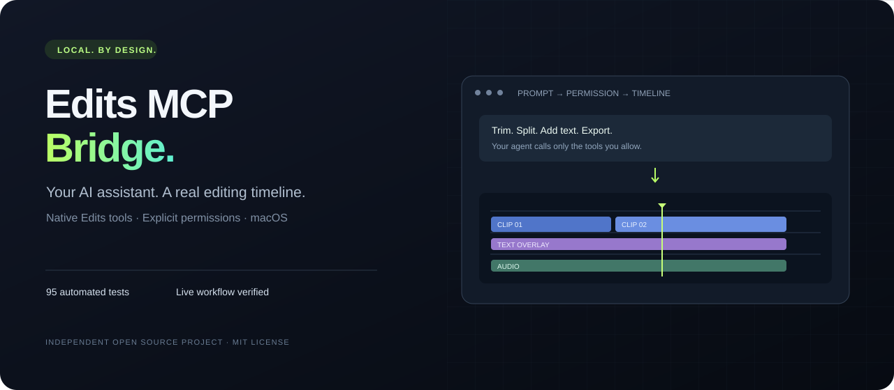

# Edits MCP Bridge

**AI asistanını macOS'teki Instagram Edits'e bağla.** Gerçek yerel araçları keşfet, açıkça izin verdiğin araçlarla kurgu yap ve videoyu dışa aktar.

[English](README.md) · [Test raporu](TESTING.md) · [Canlı test kanıtı](docs/LIVE_ACCEPTANCE.md) · [Güvenlik](SECURITY.md) · [Gizlilik](PRIVACY.md)



Edits'in kendi **Automation MCP** arayüzünü stdio istemcilerine bağlayan bağımsız bir açık kaynak projedir. Meta veya Instagram tarafından yayımlanmaz veya onaylanmaz.

## Doğrulananlar

- **95 otomatik test** başarılı: 81 JavaScript ve 14 Python. Ayrı bir temiz kurulumda da tekrarlandı.
- Edits 454.0.0 ile **274 gerçek native araç** keşfedildi. Katalog sayısı ekrana/sürüme göre değişebilir; tüm araçların tek tek test edildiği anlamına gelmez.
- Yeni bir test projesinde içe aktarma, kısaltma, bölme, yazı ekleme, kaydetme, yeniden açma ve MCP üzerinden dışa aktarma tamamlandı.
- Gerçek çıktı: **5 saniye, 2560×1440, 30 fps, HEVC video + AAC ses**. Dosya bağımsız araçlarla analiz edilip tamamen çözüldü; yazı katmanı görsel olarak doğrulandı.
- Yayımlanan demo yalnızca yapay olarak üretilmiş test görüntüsü ve sesidir. Kişisel medya veya bilgisayar ekranı içermez.

## Kurulum

macOS üzerinde Edits, Node.js 22+, npm ve yerel tanılama aracı için `/usr/bin/python3` gerekir.

```sh
git clone https://github.com/vizyonajans/edits-mcp.git
cd edits-mcp
npm ci --ignore-scripts
npm run smoke
```

Edits'te **Settings → Automation → Enable Automation Server** seçeneğini açın. Uygulamanın gösterdiği endpoint'i kullanın; gözlemlenen varsayılan adres `http://127.0.0.1:19501/mcp`.

Anahtarı Terminal'de görünmeden, depo dışında özel bir dosyaya kaydedin:

```sh
mkdir -p "$HOME/.config/edits-mcp"
chmod 700 "$HOME/.config/edits-mcp"
python3 scripts/save-token.py "$HOME/.config/edits-mcp/access.token"
```

MCP istemcinize [examples/mcp.json](examples/mcp.json) ayarını ekleyin. Node, sunucu ve anahtar dosyası yollarını kendi mutlak yollarınızla değiştirin. Anahtarı JSON içine, GitHub'a veya sohbete yapıştırmayın.

Başlangıç ayarı `EDITS_ALLOWED_TOOLS="[]"`, `EDITS_ALLOW_WRITES="0"` olmalıdır. Bu durumda katalog okunabilir ama hiçbir native araç çağrılamaz. Önce `edits_catalog` ile gerçek şemaları inceleyin; kullanacağınız tam araç adlarını izin listesine ekleyin. Kurgu araçları için ayrıca yazma bayrağını `1` yapmanız gerekir.

## Üç köprü aracı

| Araç | İşlev |
| --- | --- |
| `edits_status` | Yerel kurulum, imza kontrolü ve köprü politikasını raporlar. |
| `edits_catalog` | Edits'in güncel araç adlarını ve gerçek girdi şemalarını getirir. |
| `edits_invoke` | İzin listesi, yazma kilidi ve şema denetiminden sonra native aracı çağırır. |

## Dosya izinleri

Bir dosya yolunu API'ye vermek, Edits'e o dosyayı açma izni vermez. Canlı testte, ilk import macOS sandbox bookmark hatası verdi. Dosya **Edits → File → Import Media** seçicisiyle bir kez seçildikten sonra MCP import başarılı oldu.

Dışa aktarmada Edits'in erişebildiği bir klasör kullanın. `export` çağrısının `ok: true` yanıtı yalnızca işin kabul edildiğini gösterir; **`exportStatus` tamamlanmayı doğrulamalıdır**. Denemede uygulamanın kendi export akışının oluşturduğu klasör çalıştı; izin verilmemiş farklı bir klasör reddedildi.

Bu köprü Erişilebilirlik, Apple Events veya Ekran Kaydı izni kullanmaz. Edits'in kendi özelliklerinin istediği izinler ayrı değerlendirilir.

## Test ve güvenlik

```sh
npm test
npm run test:coverage
npm run test:python
npm run smoke
```

Kimlik doğrulamalı ama kurgu yapmayan canlı katalog testi:

```sh
EDITS_TOKEN_FILE=/absolute/private/path/access.token npm run smoke:live
```

Zaman aşımı veya iptal, gönderilmiş bir düzenlemeyi geri almaz. Yeniden denemeden önce uygulama durumunu inceleyin. Açıkça izin verilen bir native araç dosya silebilir veya yayınlama yapabilir; yeteneklerini incelemeden izin vermeyin. Ayrıntılar [SECURITY.md](SECURITY.md) dosyasında.

## İletişim ve lisans

Kullanım soruları/hatalar: [GitHub Issues](https://github.com/vizyonajans/edits-mcp/issues). Profesyonel iletişim ve özel güvenlik bildirimleri: [info@vizyoncreative.com](mailto:info@vizyoncreative.com).

[MIT Lisansı](LICENSE). Projeyi faydalı bulursanız yıldız vererek başka geliştiricilerin ve içerik üreticilerinin bulmasına yardımcı olabilirsiniz.
